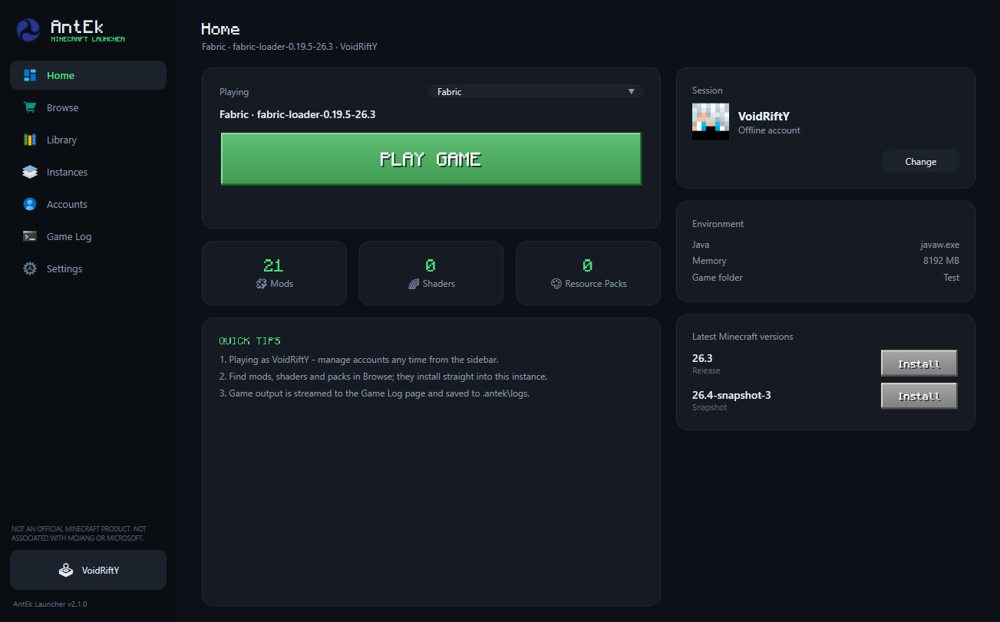

<div align="center">


# AntEk Launcher

**The Minecraft launcher, done right.**

Isolated instances, one-click mod loaders, hash-verified Modrinth downloads and
skins that actually show up — in a launcher that respects your machine.


[](https://github.com/ZStudio-lab/AntEk/releases/latest)

By **Zerith Studio Official**

</div>

---



## Features

- **Every Minecraft version** — releases, snapshots and old versions, straight from the official Mojang manifest and verified on install.
- **Four mod loaders, one click** — Fabric, Quilt, Forge and NeoForge on top of any supported version, with compatibility checks so broken combinations are never offered.
- **Isolated instances** — every instance gets its own `.minecraft` folder, so mods, shaders, resource packs, saves and configs never collide.
- **Modrinth built in** — browse and install mods, shaders, resource packs and modpacks with hash-verified downloads and authentic project icons.
- **A library that stays tidy** — enable, disable, import or remove content per instance.
- **Accounts your way** — Microsoft sign-in via the device-code flow, or offline profiles with Java-compatible UUIDs.
- **Skins that show up** — Mojang uploads for Microsoft accounts; local skins for offline profiles, in singleplayer too.
- **Live game log** — stdout and stderr stream to a dedicated log page and are saved per session.

## Privacy & safety

You shouldn't have to trust a download you can't inspect.

**AntEk does**

- Install into your own user folder — no administrator rights required.
- Add a Start Menu entry and a normal uninstaller in Windows Settings.
- Download game files and content from official sources, checking published hashes first.
- Keep everything in one folder: `%APPDATA%\.antek`.
- Run only while the launcher or game is open.

**AntEk never**

- Shows ads, or sends telemetry or analytics of any kind.
- Bundles toolbars, extras or "recommended offers".
- Installs background services or scheduled tasks.
- Touches System32, your browser or other applications.
- Uploads your worlds, mods or account details.

Every release is published here with a **SHA-256 checksum** you can verify before installing.

## Install

1. Download the installer from the [latest release](https://github.com/ZStudio-lab/AntEk/releases/latest).
2. Run it. AntEk installs for your Windows account — no admin rights needed.
3. Sign in with Microsoft, or create an offline profile, pick a version and play.

### Verify your download

Compare the file's SHA-256 with the value in the release notes:

```powershell
certutil -hashfile AntEk-Setup.exe SHA256
```

> Windows SmartScreen may ask you to confirm the first launch, as it does for any
> new independently published app. You can verify the checksum first.

### Uninstall

Use **Settings → Apps → Installed apps → AntEk Launcher**. The uninstaller removes the
program, shortcuts and registry entry, and **never deletes your worlds or data** in
`%APPDATA%\.antek`.

## Requirements

| | |
|---|---|
| OS | Windows 10 or Windows 11 (64-bit) |
| Java | Not required — runtimes are downloaded per version |
| Disk | ~250 MB for the launcher; game files download on demand |
| Account | Microsoft account for online play, or an offline profile |

## Repository layout

```
.
├── docs/                  # Landing page (served with GitHub Pages)
│   ├── index.html
│   ├── styles.css
│   ├── script.js
│   └── assets/
├── scripts/
│   └── publish-release.ps1  # Publish an installer to GitHub Releases
├── .github/
│   ├── workflows/pages.yml  # Deploy docs/ to GitHub Pages
│   └── ISSUE_TEMPLATE/
```

## Publishing a release

Builds are attached to [Releases](../../releases) as assets — not committed to the
repository. From a PowerShell terminal with the [GitHub CLI](https://cli.github.com/)
installed and authenticated (`gh auth login`):

```powershell
./scripts/publish-release.ps1 -Version 2.1.0 -Installer "C:\path\to\AntEk-Setup.exe"
```

The script computes a SHA-256 checksum, writes `SHA256SUMS.txt`, and creates the release
with both files attached. Add release notes with `-NotesFile`.

## Contributing

Bug reports and feature requests are welcome — please use the issue templates.
This is a proprietary project and does not accept external code contributions.

## License

© 2026 Zerith Studio Official. All rights reserved. See [LICENSE.md](LICENSE.md).
AntEk is free to download and use; it is **not** open source.

## Disclaimer

"Minecraft" is a trademark of Mojang Synergies AB. AntEk is an independent, unofficial
launcher and is **not** approved by or associated with Mojang or Microsoft.
